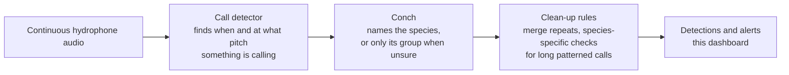

# Sea Who's Calling

Real-time whale and dolphin identification from existing hydrophones, built for
the Ocean Hackathon 2026 (Victoria, BC) and winner of the VIC03 "What's that
sound?" challenge.

Only 76 Southern Resident killer whales remain, and their home waters are also
where Canada's Pacific naval fleet trains. Sonar and underwater detonations
harm whales that are close. Sea Who's Calling listens to the hydrophones that
are already in the water and tells a sonar operator, in seconds, which species
is calling, where, and how sure the model is, so sonar can hold while an animal
is near and resume as soon as it is not. Fewer animals harmed, fewer delays.

**Headline result:** our classifier, Conch, names **83 of every 100 calls
exactly right, against 65 for Perch 2.0** (Google DeepMind's bioacoustics
model), on 945 expert-labelled calls from 7 recording days it never trained on
(mean of 3 training runs of each model). Details and limits are in
[How well it works](#how-well-it-works).

This repository is the public face of the project: the web dashboard. The
detection pipeline behind it, including Conch, is proprietary and is not
included.

**Contents**

- [Run it](#run-it)
- [How it works](#how-it-works): [the pipeline](#the-pipeline), [inside the model](#inside-the-model)
- [How well it works](#how-well-it-works): [how we measured it](#how-we-measured-it), [Conch vs Perch 2.0](#conch-vs-perch-20), [other models](#other-models-we-benchmarked), [known limits](#known-limits), [what we are working on now](#what-we-are-working-on-now)
- [What is real and what is simulated](#what-is-real-and-what-is-simulated)
- [Building on the app](#building-on-the-app)
- [Licence and credits](#licence-and-credits)

---

## Run it

Requires Node.js 18 or later.

```bash
npm install        # first time only
npm run dev        # http://localhost:5173
npm run build      # type-check (tsc -b) then production build into dist/
npm run preview    # serve dist/ at http://localhost:4173
```

The URL option `?feedSeconds=N` (N ≥ 2) speeds up the simulated live feed, for
example `http://localhost:5173/?feedSeconds=5`. It only affects the demo feed.

**Stack:** React 18, TypeScript 5, Vite 6, Leaflet 1.9 with react-leaflet 4. No
UI framework and no state library. Exact versions are in `package-lock.json`.

---

## How it works

Conch is a purpose-built classifier for marine mammal calls. It was trained on
expert-annotated hydrophone recordings from Ocean Networks Canada (ONC) and
names the species behind a call: Pacific white-sided dolphin, Risso's dolphin,
fin whale, humpback whale, sperm whale, killer whale and blue whale.

The model, its weights, its training recipe and the training data are not
published. What follows is what we can say about how it is built and how it
performs.

### The pipeline

Naming a call is only half the job: on a live hydrophone nobody has cut the
call out first. Since the hackathon the project has grown from a classifier
into a full pipeline that listens to continuous recordings and turns them into
the detections this dashboard shows.



- **Detector.** Scans the whole recording, low rumbles to high whistles and
  clicks, and marks each stretch that looks like an animal call.
- **Conch.** Names the species behind each marked call. It is hierarchical:
  when it is not sure of the species it says the group instead ("baleen whale,
  species unsure") rather than guessing, and on muffled recordings it only
  names the group.
- **Clean-up rules.** Merge calls that belong to one encounter and run extra
  checks for species whose calls are long and patterned, so one animal does
  not raise a stack of alerts.
- **Scoring.** The whole pipeline is scored against ONC's expert annotations
  on recording days the model never trained on, the same way it would face a
  new day of live audio. Rules are fixed before a test is scored, except the
  detector thresholds, which were set on the five benchmark days the pipeline
  is scored on, so those pipeline scores are not a fully blind test.

### Inside the model

**Detector.** A convolutional plus recurrent network that reads the recording
as a spectrogram and gives a call score every 0.5 seconds. It has two
branches, one for baleen whales and one for toothed whales (dolphins, sperm and
killer whales), and the final detector is the average of 3 training runs. Three
helpers work beside it:

- **Low rumble detector.** A second network of the same kind that listens only
  to about 5 to 121 Hz, where blue and fin whale calls sit.
- **Blue whale B call tracker.** Not a trained model: a fixed rule that
  follows the tone of the B call at 38 to 52 Hz.
- **Humpback model.** Humpback answers come mostly from Google's public
  humpback whale model ([Allen et al. 2021](https://doi.org/10.3389/fmars.2021.607321)),
  which we use as a ready-made component. Where it hears a humpback, its answer
  replaces ours; where it hears nothing, we keep only our own humpback calls
  that pass a consistency check.

**Classifier.** Conch looks at every call through four spectrograms of the
same clip, each tuned to a different kind of sound. One ResNet-18 image
network, started from ImageNet, reads each view.

| View | Good for | Frequency range | Audio shown |
|---|---|---|---|
| Low | blue and fin whale calls, low humpback notes | 10 Hz to 3.2 kHz | 15 s |
| Rhythm | humpback and killer whale calls, click rhythm, whistles | 50 Hz to 8 kHz | 5 s |
| High | dolphin clicks and whistles | 1 to 30 kHz | 1.5 s |
| Click zoom | the shape of a single click, sperm whale clicks | 1 to 32 kHz | 0.05 s |

The four views are joined and feed a species tree: baleen or toothed first,
then down towards the species. At each group the tree can choose to stop and
answer with the group instead of guessing, which is where the "species unsure"
answers in the pipeline above come from.

**Training data.** The classifier learned from expert-labelled call clips from
two ONC sites, Barkley Canyon (2013 to 2014) and Clayoquot Slope (2025): 11,936
clips with 11 labels, about 8 hours in all. Clips are split by recording day,
so a test day is never seen in training; the training part is 8,387 clips,
about 6 hours. The detectors learned from about 440 hours of raw recordings
from Barkley Canyon (2013 to 2014): roughly 360 hours from expert-labelled days
and 80 hours of background from 80 unlabelled days. Apart from the ImageNet
start and Google's humpback model, no outside audio is used.

---

## How well it works

### How we measured it

- **Test set.** 945 species-labelled calls from 7 recording days that were held
  out of training, so the model has never heard those days. These sit inside a
  held-out split of 12 days and 1,729 clips; the other clips carry only group
  labels such as "dolphins". Only 7 days is a small sample, and the same split
  was used repeatedly while the model was being developed.
- **Benchmark.** We compared against Perch 2.0, Google DeepMind's
  state-of-the-art bioacoustics foundation model, run the way Google recommends
  for marine work: frozen Perch embeddings with a classifier trained on top
  (van Merriënboer et al. 2025, arXiv:2508.04665; Burns, Harrell et al.
  2025, "Perch 2.0 transfers 'whale' to underwater tasks", arXiv:2512.03219).
  Both models learned from the same data and were scored on the same test
  calls.
- **Scoring.** A call counts as right only if the final answer names the
  expert's species. A group answer such as "dolphins" counts as a miss. Because
  only 7 days carry species labels, the uncertainty is wide: Conch's 83% has a
  95% interval of 69 to 91% across days, and its lead over Perch 2.0 is 17.5
  points (95% interval 9 to 26).

### Conch vs Perch 2.0

| | Conch | Perch 2.0 |
|---|---|---|
| Species named right | **83%** | 65% |
| Macro-F1, all 11 labels on all 1,729 test clips | **0.58** | 0.51 |

Per species (share of each species' test calls named right; Conch and Perch 2.0
are means of 3 runs):

| Species | Calls | Conch | Perch 2.0 |
|---|---|---|---|
| Pacific white-sided dolphin | 23 | **86%** | 16% |
| Risso's dolphin | 26 | **78%** | 35% |
| Fin whale | 240 | **88%** | 40% |
| Humpback whale | 452 | **94%** | 89% |
| Sperm whale | 69 | 59% | **62%** |
| Killer whale | 73 | 11% | 11% |
| Blue whale | 62 | **97%** | 93% |

Conch is ahead on five of the seven species, level on killer whales and
slightly behind on sperm whales (the intervals overlap broadly). Perch 2.0 was
built mostly from bird and land-animal recordings; it is close on humpback and
sperm whales and falls furthest behind on the dolphins and the fin whale.

Killer whales are the hard case for both models: their calls overlap with the
dolphins', and the 73 test calls include 68 from a single day, so no firm
conclusion about killer whales can be drawn. We report the number rather than
hide it.

### Other models we benchmarked

The same protocol (frozen embeddings, a classifier trained on top) applied to
every other public bioacoustics encoder that fits the task. Species named right,
same 945 calls. Conch, Perch 2.0, BirdNET and the Google whale model are means
of 3 runs; the other four are single deterministic runs:

| Model | From | Species named right |
|---|---|---|
| **Conch** | this project | **83%** |
| Perch 2.0 | Google DeepMind | 65% |
| BirdNET V2.4 | Cornell Lab of Ornithology / Chemnitz | 64% |
| Perch 1.0 | Google | 63% |
| SurfPerch | Google | 63% |
| BirdAVES | Earth Species Project | 62% |
| AVES-bio | Earth Species Project | 60% |
| Google multispecies whale | Google | 44% |

Every general-purpose model struggles with the two dolphins. The Google whale
model, trained on eight whale species, is the weakest here even on humpback and
blue whales, which matches Google's own findings in the Perch marine paper.

### Known limits

- **One main site.** Nearly all training audio comes from Barkley Canyon.
  Clayoquot Slope adds only toothed whale clicks.
- **New regions need new labels.** The model does not carry over to a new
  place for free. At Monterey Bay, killer whale detection was weak until we
  added labelled recordings from other Canadian hydrophones.
- **Not yet trialled at sea or in real time.** Every score above comes from
  recorded days, not a live deployment.
- **False alerts.** On five held-out days our detector, tuned for about 100
  alerts an hour that touch no expert-marked call, gave about 115 an hour.
  Experts mark roughly one call per species per recording, so some of these
  are real calls nobody labelled, but a person still needs to check alerts.

### What we are working on now

- Holding up on hydrophones and populations the model has never heard: we
  test the unchanged pipeline on independent, expert-labelled recordings from
  other sites.
- More labelled days without asking experts for more of their time: a
  listening check where volunteers answer yes / no / unsure on calls the
  pipeline flags, checked against hidden expert-labelled clips.
- Connecting the live pipeline to this dashboard (see
  [Connecting the backend](docs/DEVELOPERS.md#5-connecting-the-backend-step-by-step)).

---

## What is real and what is simulated

The app runs entirely on example JSON files. There is no backend in this
repository and no audio ships with it.

| Feature | Today | Where |
|---|---|---|
| Hydrophone list and metadata | Example JSON (public ONC site names, approximate positions, placeholder hardware) | `data/hydrophones.json` |
| Species list | Example JSON (five species shown in the UI) | `data/species.json` |
| Current detections ("Most recent") | 5 example detections | `data/detections.json` → `live` |
| New detections arriving | **Simulated**: one every 20 s from a fixed pool | `src/data/liveFeed.ts`, `data/detections.json` → `simulationPool` |
| Detection history | **Simulated** for every site, with seasonal patterns, generated by `scripts/make_simulated_history.mjs` | `data/history-simulated.json` |
| Spectrogram thumbnails | None shipped; cards show a plain strip with the species' frequency range | `src/lib/spectrograms.ts` |
| Shipping lanes | Hand-drawn illustrative lines | `data/shipping-lanes.geojson` |
| "Now" | **Fake clock** pinned to 2026-10-17 15:08 PDT, then ticking | `src/data/clock.ts` |
| Audio clips | None shipped; the play button runs a silent timer until `audioUrl` is set | `src/lib/usePlayback.ts` |
| "2 operators watching" | Hard-coded number | `src/App.tsx` |
| Export (CSV / GeoJSON / JSON) | **Real**: built in the browser from the filtered rows | `src/lib/export.ts` |

---

## Building on the app

Building on the app or connecting a backend? See
[docs/DEVELOPERS.md](docs/DEVELOPERS.md): folder map, data contract, UI rules,
selection and layout behaviour, and a step-by-step backend guide.

---

## Licence and credits

MIT for the app only (see `LICENSE`). The classifier, its training code and all
recordings live elsewhere and are not part of this repository.

- **Team:** Grace Bertozzi, Jossie Yan, Leanne Farmer, Pranav Rajesh Krishnan,
  Olivia Whitelaw.
- **Recordings and expert annotations:** Ocean Networks Canada (ONC).
- **Humpback model:** Allen et al. 2021 (Google and NOAA).
- **Benchmark models:** Perch 2.0 (Google DeepMind), plus the public encoders
  listed under [Other models we benchmarked](#other-models-we-benchmarked).
